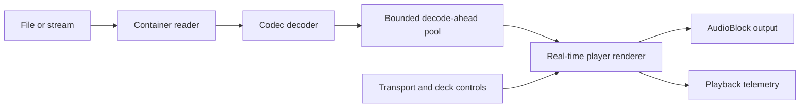
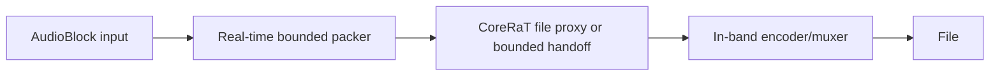

# Media Playback, Recording, and Device I/O

## Purpose

This document defines the architecture for audio-file players, codec-aware file sinks, and live audio-device adapters. It is normative for ownership and real-time boundaries; individual codec and device choices remain incremental implementation decisions.

MusicRaT does not expose compressed packets as graph audio. Files and devices terminate in adapter modules, while the graph carries `AudioBlock`, transport, control, and telemetry messages.

## Processing Boundary

Media playback is split into preparation and rendering:



The reader and decoder run in-band and may perform file I/O, allocate codec state, parse metadata, and fill a bounded pool of decoded planar PCM chunks. The real-time renderer acquires fixed pool slots atomically and performs sample conversion, interpolation, channel mapping, fades, and timeline accounting only.

A decoder is never called directly from `process()`. A cache miss produces deterministic silence or a held/faded sample according to policy, sets `AUDIO_BLOCK_UNDERRUN`, and increments telemetry; it never falls back to synchronous decoding.

The initial `VarispeedRenderer` uses the silence policy. Graph time and output sequence continue during starvation, while media position stalls until a matching decoded chunk is available. A transport-following coordinator may instead request a generation-safe seek when the accumulated sync error exceeds its correction threshold.

## Decoder Contract

A codec backend owns both container demuxing and elementary-stream decoding when the selected library combines them. Its non-real-time interface must support:

- Probe/open from a path or prepared stream.
- Report codec, duration when known, native sample rate, channel layout, and seek capability.
- Decode bounded planar PCM chunks into caller-owned or pool-owned storage.
- Seek to a media-frame position and report the actual decoded start position.
- Flush codec delay and stale packets after seek.
- Distinguish end-of-stream, recoverable starvation, malformed input, unsupported format, and fatal I/O errors.
- Close without requiring the real-time thread.

Decoded chunks carry media-frame start position, frame count, channel count, sample rate, generation, discontinuity flags, and PCM data. The initial pool may use the application `AudioBlock` capacities, but decoded storage is an internal backend type rather than a CommRaT wire message.

Codec libraries are optional backend dependencies. The first implementation order is:

1. PCM WAV using an internal deterministic reader.
2. FLAC for lossless library-backed decoding and golden tests.
3. MP3 and AAC for common performance media.
4. Opus for network-oriented and low-latency assets.

No public module type is named after a third-party codec library. Unsupported codecs fail during prepare/open and are reported through bounded status telemetry.

`DecoderBackend` is the implemented compile-time contract for these operations. `DecodeAhead<Decoder, ChunkCount>` owns any conforming decoder and feeds the common preallocated pool; codec code is therefore absent from the renderer and real-time coordinator. The contract is validated independently with an in-memory decoder.

Each backend reports a stable `DecodeError` category for its most recent failed operation: invalid argument, file open or I/O failure, unsupported format, invalid metadata, resource exhaustion, seek failure, corrupt data, backend failure, or pool publication failure. Codec-native failures are normalized at the backend boundary so `PlaybackStatusBlock` remains independent of optional library ABIs. A successful open, seek, or decode clears the previous error.

`WavReader` accepts PCM16 RIFF/WAVE, traverses padded unknown chunks, reports fixed stream metadata, decodes into caller-owned bounded `AudioBlock` storage, and supports frame seeks with a discontinuity marker. `FlacReader` uses optional libFLAC stream decoding with all file reads and seeks routed through `corerat::File`. It keeps one decoded FLAC frame in fixed storage and rejects streams whose declared maximum block size exceeds `AudioBlock::MAX_FRAMES`; libFLAC allocation and codec work remain on the player worker. `MUSICRAT_FLAC_SUPPORT` accepts `AUTO`, `ON`, or `OFF`: `AUTO` enables the backend when pkg-config finds libFLAC, while `ON` makes its absence a configuration error.

`Mp3Reader` uses optional libmpg123 decoding with caller-owned read and seek callbacks backed by `corerat::File`. Open performs a worker-side scan to establish duration and a seek index, fixes output to native-rate signed PCM16 mono or stereo, and converts interleaved samples into bounded planar storage. Decoder allocation, scanning, seeking, and compressed-file I/O remain on the player worker. `MUSICRAT_MP3_SUPPORT` accepts `AUTO`, `ON`, or `OFF` with the same optional-dependency semantics; Debian-family systems provide the pkg-config dependency through `libmpg123-dev`.

`AacReader` and `OpusReader` use optional FFmpeg demuxing and decoding with a custom `AVIOContext` backed by `corerat::File`. The shared bounded backend accepts only its declared codec ID, converts decoded native-rate audio to interleaved signed PCM16 through libswresample, and then publishes planar blocks. Seeking uses stream timestamps, flushes decoder and resampler state, discards preroll before the requested media frame, and marks the first returned block discontinuous. All FFmpeg allocation, probing, demuxing, decoding, seeking, and resampling remain on the player worker. `MUSICRAT_AAC_SUPPORT` and `MUSICRAT_OPUS_SUPPORT` independently accept `AUTO`, `ON`, or `OFF`. Debian-family systems provide the required pkg-config modules through `libavformat-dev`, `libavcodec-dev`, `libavutil-dev`, and `libswresample-dev`.

`DecoderDispatcher<Backends...>` probes registered backends in order and exposes the selected backend through the same `DecoderBackend` contract. `MediaDecoder` conditionally registers strict FLAC, AAC, and Opus probes before MP3, followed by the always-available `WavReader`. Additional formats extend that registry without changing the player or renderer.

## Decode-Ahead and Handoff

The decode-ahead pool has fixed capacities selected before playback starts:

- Chunk frame capacity.
- Chunk count and maximum channel count.
- Low/high refill watermarks.
- Maximum seek/preroll window.

Ownership transfers through a bounded single-producer/single-consumer index queue or an equivalent proven CoreRaT primitive. PCM buffers themselves remain preallocated and are recycled; they are not copied into an unbounded queue.

The worker may block waiting for free chunks. The renderer never blocks waiting for decoded data. Queue saturation, starvation, discarded stale chunks, and decode errors are observable telemetry.

The pool reports a generation-filtered half-open buffered envelope `[buffered_start_frame, buffered_end_frame)`. It includes ready chunks and chunks currently held by the renderer, so loop-pinned audio remains visible. The envelope is empty when both values are zero. Because it is an envelope over a fixed pool rather than a list of intervals, it may span gaps after nonsequential retention.

Every committed track load or successful seek advances the player generation.
Failed replacement preparation leaves the active generation intact. The renderer
rejects chunks from older generations. This prevents pre-seek audio from leaking
after an asynchronous seek without requiring a queue clear on the real-time thread.

`PlaybackCoordinator<Decoder, ChunkCount>` owns the format-neutral decode-ahead and rendering sides of this boundary while leaving worker scheduling to its caller. `WavPlaybackCoordinator` is the PCM WAV alias. Worker-side open, seek, close, and refill methods never run on the audio thread. A lock-free versioned snapshot publishes generation, target media frame, and channel count. While that snapshot is changing, the audio side releases old leases and emits bounded underrun silence; after publication it adopts the new generation at the next render boundary. Rejected seeks preserve the current generation and media position.

## Player Timeline and Controls

A player tracks two positions:

- **Media position:** source frames on the decoded asset timeline.
- **Render position:** frames emitted on the graph clock timeline.

The public player parameters are persistent defaults. Timestamped deck and transport changes use bounded streaming events; discrete prepare/load operations use commands.

Required deck operations are:

- Play, pause, stop, and return to cue.
- Absolute seek and bounded relative seek.
- Set/clear cue point.
- Set, enable, and disable a loop.
- Playback rate and direction.
- Pitch-lock mode.
- Master/follower sync selection and phase nudge.

Loading a path is an imperative command because it may fail and requires preparation. The command schedules in-band loading and replies with accepted/rejected state; readiness is reported separately when decoding has reached the required watermark.

### Prepared Track Replacement and Load Results

The launchable player uses
[`PreparedPlaybackCoordinator`](../include/musicrat/backends/media/prepared_playback_coordinator.hpp)
around two preallocated playback slots. The ordinary decoder worker opens and
fills the inactive slot before publishing a handoff. An open failure, initial
decode error (including one after partial candidate output), or lack of prepared
PCM rejects the candidate without closing the active track or changing its
position, rate, cue state, or generation.

The render thread adopts prepared storage only at an audio-block boundary.
It releases old renderer leases before acknowledging retirement; only then may
the worker close and reuse the old decoder/pool. No decoder open/read/close,
destruction, mutex or filesystem call is added to the render handoff.
Both slots and optional pitch processors are constructed before processing.
This doubles the player's pool/renderer storage: two pools of four chunks each,
using the configured audio capacities, plus codec and optional pitch state.
The physical-target memory/performance budget is still unvalidated.

`FilePlayer::protect_playing_loads` defaults to **true**, with stable parameter
ID 8 and descriptor metadata. When the current track is marked playing at the
commit boundary, a replacement is rejected as `MEDIA_LOAD_PROTECTED`.
Initial loading into an empty deck is allowed. Runtime requests obey the
persistent policy; they cannot bypass it through a command flag. Explicit
configuration can disable protection. Lifecycle restoration of `params.path`
is separate from runtime replacement and bypasses this protection.
If pause/play arrives in the same block, protection uses the pre-control state
at that boundary. Pausing an accepted replacement does not automatically retry it.

On commit, rate and play/pause state are preserved; the new media cursor starts
at zero, track-local cue/loop coordinates are cleared, and a discontinuity is
reported. Controls already assembled for the old track in that block are
discarded rather than applied to the new track. Pending quantized actions and
transport seek intents are cleared across the generation change.

`LoadMedia` retains its path-only request. Its reply now includes:

- `accepted`: the request was queued, **not** loaded.
- `request_id`: a nonzero, player-assigned monotonic ID for an accepted load.
- `rejection`: explicit invalid/embedded-NUL path, busy, or ID-exhaustion reason
  for a rejected request (whose ID is zero).

Only one runtime request may be queued/in flight; load preparation/commit
cannot be overwritten by another load, seek, or unload command. Lifecycle
disable cancels queued or unadopted loads and unloads; a handoff already claimed
by the renderer finishes before retirement/unload. Blocking codec/filesystem
operations are not forcibly cancelled and have no hard deadline.

Match the reply ID against `PlaybackStatusBlock::load_request_id`.
`load_state` distinguishes idle, preparing, prepared (awaiting the renderer),
committed, failed, playing-deck-protected, and cancelled. `load_decode_error`
describes candidate failure independently of the active track's `decode_error`.
`track_instance_id` is the request ID that created the active track, or zero
when unloaded; it persists across seeks. It is local to the player lifetime,
not a durable library/content identity. These fields are the latest load
snapshot, not a durable result queue: clients should wait for their matching
terminal result before submitting another request. A newer request may replace
the previous snapshot. All communicating binaries must be rebuilt for the
extended command reply and playback-status wire shapes.

This guarantees resource retention on preparation failure, not uninterrupted
audio under arbitrary preparation times. Candidate probing/decoding currently
shares the ordinary decoder worker with active-track refill. Long preparation
can exhaust the existing bounded active pool and cause explicit underrun.
Separate preparation/refill scheduling and measured resource budgets remain
required before promising dropout-free browsing/loading. A decode failure
after commit belongs to the new active track; automatic rollback is not added.

The command handler still uses its existing ordinary mutex/condition-variable
ingress. Its EVL callback execution domain requires audit; native tests do not
certify that RPC path as OOB-safe. The render-side varispeed handoff is tested
without allocation or decoder calls; optional pitch-lock behavior and the
complete module still require SDK/QEMU and physical validation.

Browser selection is not connected yet. `LoadMedia` still accepts the existing
raw path, with no configured-root confinement or snapshot revalidation. A
future selection/load owner must revalidate root-relative browser entries and
correlate browser intent with these player load IDs before enabling a Load
button. The development browser preview remains selection-only.

### Playback Rate

Rate has two explicit modes:

- **Varispeed:** resampling changes tempo and pitch together. Source advance is `rate` media frames per nominal output frame after sample-rate conversion.
- **Pitch lock:** a time-stretch engine changes tempo while preserving pitch, with documented algorithmic latency and supported rate range.

The player implements pitch lock as an optional Rubber Band 3 real-time stage after varispeed rendering. Varispeed controls source advance and graph timing; Rubber Band applies the inverse pitch scale at unity time ratio. The R2 engine runs single-threaded with a short window, dynamic-pitch consistency, a fixed maximum process size, and fixed MusicRaT conversion buffers. Construction, configuration, and start padding occur before normal rendering. The supported pitch-lock rate range is `0.5..2.0`; plain varispeed remains `0.25..4.0`. `MUSICRAT_RUBBERBAND_SUPPORT` accepts `AUTO`, `ON`, or `OFF` and the dependency is GPL-2+.

Pitch-lock latency is the Rubber Band start delay for the selected configuration and is published as `algorithmic_latency_frames`. Real-time start padding and delay trimming preserve stream alignment; output not yet available is explicit underrun silence. Discontinuities reset the pitch processor before the affected block. The varispeed renderer writes the effective rate for every output frame into caller-owned fixed storage. The pitch processor consumes contiguous equal-rate segments from that trace, so immediate changes begin at their declared sample offset and ramps update the inverse pitch scale for every rendered frame. Rate events outside the active pitch-lock range are rejected before they alter media position.

Reverse playback requires reverse-capable decode-ahead and is a separate milestone; it must not imply arbitrary backwards operation for every codec.

Rate, nudge, and pitch changes are smoothed. Values outside the backend's declared range are rejected during configuration or clamped according to explicit parameter metadata.

The allocation-free `VarispeedRenderer` consumes a bounded span of decoded chunk views, rejects stale generations, uses absolute media-frame position, interpolates across chunk boundaries, performs sample-rate conversion, and emits a complete requested graph quantum. `DecodeAheadRenderer` retains unread pool leases across calls and releases only fully consumed chunks. Pause and decode starvation emit silence without advancing media position; end-of-stream and unavailable-data frames are explicitly flagged.

`DeckControlEventBlock` carries bounded, sample-offset play, pause, immediate-rate, ramped-rate, cue, and loop events. These events are applied inside the render loop, including during decode starvation, so graph-time controls update deck state without advancing the stalled media timeline. Cue returns and loops are accepted only when their source frames are resident in the fixed decode-ahead window. An enabled loop pins overlapping pool leases and uses a half-open `[start, end)` range; wraps and cue returns mark the audio and playback-status blocks discontinuous. Controls outside the resident window are rejected without changing media position. Load and arbitrary seek remain worker-owned operations because they change decoder state and generation.

### Beat and Transport Sync

Beat-grid analysis is prepared off the real-time thread or loaded from session metadata. A beat grid contains a stable origin, tempo segments, meter, confidence, and optional downbeat markers.

A synchronized player consumes the graph `TransportBlock` and maps transport position to media position. Sync has independent controls for:

- Tempo matching.
- Beat-phase alignment.
- Bar/downbeat alignment.
- Quantized cue, loop, and start actions.

One transport source is the graph master. Decks are followers and must not silently compete for clock ownership. Manual pitch bend/nudge temporarily offsets phase without rewriting the persisted beat grid. Large corrections use a discontinuity/seek; small corrections use a bounded rate adjustment.

`MusicRaTTransportSource` is the launchable graph master. It publishes a deterministic position from its configured period, tempo, sample rate, meter, and play state. `MusicRaTAudioFilePlayer` accepts its `TransportBlock` as a second optional synchronized input. Tempo mode follows master tempo; beat and bar modes additionally apply bounded phase nudges, while discontinuities and phase errors beyond the threshold enqueue generation-safe worker seeks. Explicit deck controls are applied after transport decisions within a render block. Sync mode, beat positions, phase error, following state, and pending seeks are included in playback telemetry.

Deck events may request immediate, next-beat, or next-bar execution. A bounded quantizer converts due actions into the renderer's existing sample-offset controls and retains future actions in fixed storage; pending actions are cleared across subsequent media generations so stale cue or loop operations cannot leak across loads and seeks. Quantized play, cue return, and loop enable use the same allocation-free renderer path as immediate controls. Playback telemetry reports pending and dropped quantized actions plus received deck-control and transport block counts.

Timer-driven CommRaT modules fetch synchronized inputs against the timer-loop timestamp. Unrouted trailing synchronized inputs remain invalid, preserving compatibility with player graphs that route deck controls without transport. The process launcher starts modules with synchronized dependencies after their producers.
- Synchronized inputs: optional `DeckControlEventBlock` and `TransportBlock`.
`MusicRaTDeckControlSource`, `MusicRaTTransportSource`, `audio_file_player_to_wav.json`, `audio_file_player_transport_sync_to_wav.json`, `audio_file_player_quantized_start_to_wav.json`, `audio_file_player_flac_to_wav.json`, `audio_file_player_mp3_to_wav.json`, `audio_file_player_aac_to_wav.json`, `audio_file_player_opus_to_wav.json`, and `audio_file_player_pitch_lock_to_wav.json` provide complete routed playback examples.

## File Sinks and Encoders

File sinks use the inverse split:



The implemented PCM16 WAV sink packs one complete interleaved block into fixed storage and submits it through `corerat::File`. On EVL, `corerat::File` uses the EVL proxy; header patching, seek, sync, and close occur during non-real-time lifecycle teardown. The CoreRaT STD backend performs direct POSIX I/O and is therefore suitable for offline/tests, not a claimed hard-real-time live recorder.

Compressed sinks require an in-band encoder worker because codec calls are not real-time safe. Their real-time side transfers preallocated PCM chunks through a bounded handoff. Encoder configuration includes codec, container, sample format, channel layout, bitrate/quality, metadata, and overflow policy. File extension is not used as the sole codec selector.

A recording overflow never blocks the audio thread. Policy is explicit: drop newest, drop oldest where ownership permits, or stop recording at the next lifecycle boundary. The sink reports dropped frames and marks discontinuities.

## Live Audio Devices

JACK/PipeWire, ALSA, and future portable backends terminate in dedicated adapter modules. Device callbacks only copy/convert bounded buffers, advance clock state, and update atomic counters.

A live output path must define:

- Device identity and negotiated sample format.
- Hardware and graph sample rates.
- Period size and bounded buffering depth.
- Channel-layout mapping.
- Clock-master ownership.
- Underrun policy and counters.
- Hot-plug and format-change behavior.
- Measured backend and graph latency.

The preferred Linux-first prototype is JACK or PipeWire because the server owns graph timing and device negotiation. Direct ALSA remains useful for appliances and RaTOS targets. Backend selection must not alter DSP or media protocol types.

Full duplex shares one device clock and reports capture/playback timestamp correlation. Independent input and output devices require an explicit drift-compensation policy; nominally equal sample rates are not assumed coherent.

## Module Shapes

### Audio File Player

- Output: `AudioBlock`.
- Synchronized inputs: implemented `DeckControlEventBlock`; future `TransportBlock`.
- Parameters: default path/reference, channel mapping, initial cue, initial rate, pitch-lock mode, loop defaults, decode-ahead sizing within compile-time limits.
- Commands: prepare/load, unload, seek when immediate request/reply is required, and analysis refresh.
- Telemetry: readiness, play state, positions, buffered frames, duration, codec metadata, underruns, decode errors, effective rate, sync error, and algorithmic latency.

The launchable `MusicRaTAudioFilePlayer` is the codec-neutral `Module2` implementation. It runs a private in-band decoder worker, selects a registered decoder through runtime probing, accepts asynchronous load/seek/unload commands on its audio output, consumes sample-offset deck controls, and renders through the generic playback coordinator. Its second output publishes a bounded `PlaybackStatusBlock` synchronized with each audio block. The snapshot reports generation, media-frame position, effective and supported rate range, pitch mode, algorithmic latency, output and source channel counts, source sample rate, codec, duration, resident decoded frames, the buffered source-frame envelope, worker state, the latest typed decode error, readiness/play state, and underrun, end-of-stream, discontinuity, looping, or invalid render state. Metadata is published atomically with its decoder generation; an in-progress or mismatched transition reports `PREPARING` with cleared metadata rather than a mixed snapshot. Worker `END_OF_STREAM` means decoding reached the source end and may coexist with resident frames that are still available to render. Resident frames and the buffered envelope include renderer-held chunks, including chunks pinned by a bounded loop. `MusicRaTDeckControlSource`, `audio_file_player_to_wav.json`, `audio_file_player_flac_to_wav.json`, and `audio_file_player_pitch_lock_to_wav.json` provide complete routed playback examples.

### Playback Status to LVGL

`MusicRaTPlaybackStatusUiAdapter` projects `PlaybackStatusBlock` into bounded
`WidgetUpdateBlock` observations. Its pure kernel and CommRaT `process()` are
OOB-safe bridges; LVGL calls and drawing remain on the existing ordinary,
non-EVL UI thread. The adapter does not open files, decode, perform RPC, or
estimate an independent playback position.

Selectors are defined in
[`protocol/playback_ui.hpp`](../include/musicrat/protocol/playback_ui.hpp).
They cover rate, frame position/duration, beat position, ready/playing/looping,
worker state, decode error, normalized track position, elapsed/remaining time,
and independent load state/error (selectors 12/13). Load feedback is still
projected when the audio status is invalid/unloaded, so failed initial loading
does not hide its own error. Continuous values normalize against the observation's declared range;
choices retain their wire values; booleans drive active state. Time labels use
source frames and source sample rate, not output rate or wall time, and display
`MM:SS.mmm` with minutes allowed to exceed 59. Remaining time is media time to
EOF, not an estimate of wall time at the current rate.

Unavailable duration/sample rate or invalid status yields explicit per-widget
`WIDGET_VALUE_UNAVAILABLE`, not fabricated timing. LVGL disables the affected
widget and shows `--:--.---` for unavailable time; the next valid update restores
it. Other valid observations in the same block still apply. The adapter is
stateless across seek/load generations and preserves the source timestamp and
sequence. These are rendered media-position observations, not yet calibrated
audible-time cursor anchors.

The Designer's shared graph/dropdown target catalog exposes playback
observations and strict export generates this adapter automatically. Existing
widget-update mergers combine it with meters or parameter-state adapters.
Incompatible widget kinds, properties, and normalization ranges are rejected.

With LVGL and tests enabled, CMake generates
`playback_status_to_lvgl.json` and, with SDL enabled,
`playback_status_to_sdl.json` from
[`playback_status_to_lvgl.json.in`](../examples/configs/playback_status_to_lvgl.json.in).
The example starts unloaded intentionally; set the player's `params.path` to
an available supported track to observe playback. Its audio goes to a null
sink, not physical hardware. Position and state widgets are feedback-only, not
implemented seek/play controls. The 300 ms headless smoke test exercises the
unloaded routing/lifecycle path, not track decoding or visual correctness.
Kernel, module, serialization, and headless-renderer tests cover populated
status and unavailable/recovery behavior separately.

For a native desktop preview, select the **Native LVGL SDL validation** CMake
preset and build the launcher, player, playback adapter, LVGL widget sink and
null sink. Run the VS Code task **MusicRaT SDL deck demo**, or from the repository
root:

```bash
bash scripts/run-sdl-deck-demo.sh build-lvgl-sdl-validation 1800000
```

The window is titled **MusicRaT Deck State** and runs for 30 minutes. The script
uses the existing TCP-router fixture and only stops a router it owns. This is
the unloaded, feedback-only graph above, not a browsable/operable deck.

See the [deck implementation plan](DECK_PLAYER_IMPLEMENTATION_PLAN.md) for the
browser, waveform, performance cache, and calibrated timing work still needed.

### In-Band Directory Browser Foundation

[`DirectoryBrowser`](../include/musicrat/backends/media/directory_browser.hpp)
is an in-band-only backend for the planned runtime library service. It performs
filesystem operations and allocations and must run on an ordinary Linux worker
thread, not an EVL-attached thread, the audio processing thread, or an LVGL
callback. It is single-owner and is not internally synchronized.

The bounded request/page contracts live in
[`protocol/media_library.hpp`](../include/musicrat/protocol/media_library.hpp).
Configuration resolves one existing root. Browsing accepts root-relative paths;
absolute paths, normalized parent escapes, and symlink traversal are rejected.
Symlink entries and special files are skipped with an explicit count. All
regular files are listed: an extension is not proof of codec support, and this
backend does not open or decode tracks.

A successful query captures one bounded directory snapshot, sorted directories
first and then by case-sensitive filename byte order. Pages contain at most 32
entries and expose request ID, snapshot ID, total, next offset, and `has_more`.
Later pages use the same snapshot even if the directory changes. A fresh query
(including a failed query) or reconfiguration invalidates the old snapshot;
stale page requests fail explicitly. Snapshot IDs are scoped to one browser
instance, not persisted track identities or playback generations.

The default scan limit is 4096 entries, configurable within `1..65536`. It
counts skipped entries too. Exhausting it fails the query rather than returning
a misleading partial directory; path/name overflow also fails rather than
truncating a load target. Errors distinguish missing/not-directory,
permissions/I/O, invalid requests, root escapes, scan limits, stale snapshots,
and allocation exhaustion. This bounds stored entry count and result size, not
filesystem syscall duration.

`resolve_selection()` accepts only an exact file entry from the current snapshot,
with a nonzero request ID. It rechecks the configured root's device/inode,
rejects symlink traversal, and compares the selected regular file's device,
inode, size, and nanosecond mtime/ctime against the snapshot. Missing files,
replaced/modified files, directories, invalid membership and stale snapshots
produce explicit errors with no resolved path. The identity record stays
backend-private and moves together with its entry when sorting.

These Linux/POSIX metadata checks detect ordinary changes; they are not a content
hash or a security sandbox. There is still a path-based check/open race, including
between validation and the decoder's later open. No descriptor is retained.
Descriptor-relative file ownership through decoding is required if hostile
concurrent mutation is in scope. Revalidation does not guarantee codec support.

### Asynchronous Browsing and LVGL Preview

[`DirectoryBrowserWorker`](../include/musicrat/backends/media/directory_browser_worker.hpp)
owns this backend on an ordinary, unattached `std::jthread`. Its one client
thread submits bounded query/page/selection requests and polls results without filesystem
work or mutex acquisition. One request/result slot is retained until consumed;
additional submissions return `Submission::Busy`, not success or silent
replacement. Invalid configuration is returned through typed page errors.
Typed page and selection polling do not consume each other's retained result.
Only the worker configures/scans the root, reads snapshots or validates files. Worker
destruction requests stop, wakes, and joins; it may wait for an in-progress
filesystem syscall. There is no hard scan/cancellation deadline.

[`LvglDirectoryBrowser`](../include/musicrat/backends/lvgl_directory_browser.hpp)
is an LVGL-owning-thread component with eight reused rows, folder navigation,
Up/Refresh, snapshot paging, selected-file display and explicit errors. Call
`poll()` from the presentation loop. The parent object and exclusively owned
worker must outlive the component; destroy the component before its LVGL
parent/display. No browser code runs in CommRaT `process()`.

**Use selection** first enqueues validation on the browser worker, disables
navigation while pending and shows validation failures without calling the
handler. Its optional handler receives the validated `MediaSelectionResult`,
including root-relative entry, local snapshot ID, selection request ID and
resolved path. A handler must only enqueue a bounded intent, return whether
that enqueue succeeded, and never block, resolve paths, decode, or issue RPC
from the UI callback. Without a handler the handoff is disabled. A successful
handoff is displayed as queued, **not loaded**. Validation is not a retained-file
lease; the decoder-open race described above remains.

[`control/selection_load.hpp`](../include/musicrat/control/selection_load.hpp)
provides a single-owner in-band correlation component. A validated selection
produces a bounded `LoadMedia` command; the caller performs RPC on an ordinary
worker and supplies its reply. Acceptance records the player-assigned request ID
but is not completion. Only matching playback status can report committed,
failed, protected or cancelled; commit must also match `track_instance_id`.
Unrelated player requests and duplicate terminal updates are ignored. Validation and
command rejection remain distinct from decode failures. Timeout/disconnection
is explicitly outcome-unknown, not cancellation, and blocks another load.
Late replies/status can resolve that uncertainty; malformed replies also block
reuse. Reset only after confirming a new player session, whose request IDs may
restart. This component does not perform RPC, subscribe to status, implement a
timeout clock, or itself connect the browser to the launched player.

With `BUILD_MUSICRAT=ON` and LVGL enabled, the development executable
`musicrat_lvgl_browser_preview` can exercise the component:

```bash
./build-lvgl-validation/musicrat_lvgl_browser_preview \
  --root /path/to/music --duration-ms 3000
```

Add `--sdl` in a build configured with `MUSICRAT_LVGL_ENABLE_SDL=ON` for an
interactive window (default duration: 30 seconds; maximum: 24 hours).
The headless preview returns failure for invalid roots or an initial browse
that does not finish before its deadline. It does not play audio or connect a
selection handler.

The standalone preview is not a launchable library module or Designer surface
widget. The connected prototype below now uses this same browser component.

### Connected LVGL Deck Workflow

`MusicRaTLvglDeck` combines the tested browser with native player control. It
publishes `DeckControlEventBlock`, consumes synchronized `PlaybackStatusBlock`
and uses `Remote<AudioBlock>` for `LoadMedia` commands. Its flat startup fields
are `media_root`, `backend` (0 headless, 3 SDL) and `load_timeout_ms` (1..600000,
default 10000). It is an independently launchable `Module2` with a generated
descriptor and stable port/parameter IDs. Parameters are not automatable.
Root/backend changes apply when the UI is re-enabled; changing the completion
timeout requires a new module instance.

With native LVGL enabled, CMake generates `lvgl_deck.json` (headless) and, when
SDL is enabled, `lvgl_deck_sdl.json` from
[`lvgl_deck.json.in`](../examples/configs/lvgl_deck.json.in).
Build the launcher, `musicrat_lvgl_deck`, player and `musicrat_audio_device_sink`
with an audio backend enabled (the desktop validation build uses PipeWire).
From the repository root, run:

```bash
bash scripts/run-sdl-deck-demo.sh build-lvgl-sdl-validation 1800000 \
  build-lvgl-sdl-validation/lvgl_deck_sdl.json
```

The local VS Code task **MusicRaT SDL deck workflow** invokes the same command.
The media root defaults to the working directory; edit `DeckDisplay.params.media_root`
in the generated application JSON to choose a music folder. Select a regular
file, then **Use selection**. The browser lists all regular files, not only
supported codecs, and decoding failures are explicit.

The SDL example now routes player audio to `MusicRaTAudioDeviceSink`, using the
default device (`device_name` empty), the CMake-selected default sample rate/
period and two channels. Loading with autoplay enabled can produce audible
output immediately; set a comfortable device volume before loading. To choose
an output, add `DeckOutput.params.device_name` using the backend's device
identifier. This stereo prototype does not automatically map mono or multichannel
tracks to the sink geometry: use an explicit channel mapper/configuration when
needed. The generated headless `lvgl_deck.json` deliberately retains `NullSink`
so launcher/CI smoke tests never require or open hardware. PipeWire owns its
callback thread; no device work was moved into an EVL OOB thread.

The ordinary `DeckLoadWorker` owns load RPC and result correlation. The UI only
enqueues validated selections and semantic play/pause events; bounded `process()`
only bridges status/control queues. RPC never blocks LVGL or audio rendering.
The reply deadline is 500 ms, completion timeout is configurable, and status
older than one second is stale. Overflowed status snapshots are counted and
visible; UI snapshot publication retries the current state after queue saturation.
Loads and seeks share one outstanding-operation slot, including accepted work
whose outcome is unknown.

Load feedback distinguishes validation error, not-sent/disconnected, rejection,
preparing/prepared, committed, protected, failed, cancelled and unknown outcome.
No automatic retry risks loading twice. If a pending accepted load loses status,
or status sequence rolls back, matching player-local IDs is no longer safe:
the view blocks new loads/transport until the player session is confirmed and the
deck is restarted. A completion timeout without a status gap may still reconcile
a matching late result. Session tokens and automatic reconnect remain planned.
Disabling/re-enabling the UI does not reset an uncertain load.

The 800x480 prototype has a performance page and a separate Browse page. The
header uses one symbol-only play/pause toggle and a Browse/Deck page toggle;
there is no separate Performance navigation button. Navigation preserves
browser selection. Remaining time is media duration minus media position, not
a rate-adjusted or output-latency-calibrated audible ETA. Play/pause goes
through the typed control stream, with authoritative confirmation and an
explicit not-confirmed deadline.

The performance layout follows the supplied player-screen hierarchy: compact
track/control header, wide detail waveform and full-track overview, then time,
tempo, BPM, marker and operation feedback. Zoom and waveform-color controls are
compact overlays on the detail waveform rather than a separate control row.
Elapsed/remaining time, signed tempo offset, Track BPM and Current BPM have
distinct panels. A vertical **±16% pitch fader** sits beside the detail
waveform. It maps the neutral position to rate `1.0`, sends bounded
`DECK_CONTROL_SET_RATE` events through the existing control block, and follows
the player's reported rate. The adjacent mode label reports `MT` (pitch lock)
or `VARI`; this UI does not toggle pitch-lock mode. The fader is disabled until
a connected track is available, and failed queueing or unconfirmed status is
reported rather than silently accepting a new value.

On Performance, the separate slider and Seek button have been replaced with
paused waveform gestures:

- Tap/click the whole-track overview to select an absolute source position.
- Drag inside its viewport outline to move the window, preserving the grab
  offset rather than jumping the window center to the pointer.
- Drag the detail waveform beneath the fixed playhead: dragging left moves
  forward in the track; dragging right moves backward. A detail tap alone
  does not seek (a four-pixel movement threshold distinguishes a drag).

Movement updates an orange preview, the visible window and explicitly labeled
preview elapsed/remaining time, without changing audio position. Release inside
the originating waveform submits **one** typed `SeekMedia` request through the
ordinary worker. Leaving the waveform cancels, even when re-entering before
release; so do page/zoom changes, play/pause actions, track/generation/shape
changes, disconnection, uncertainty and loss of seek eligibility. Clicking or
dragging during playback sends no seek and displays pause-to-seek guidance.
Release restores the authoritative window while completion is pending; errors
and confirmed position remain explicit.

UI and worker guards require a fresh connection, the same
observed track/generation, known duration/sample rate, a paused player, no active
loop, sync off, no decode/invalid/sync-pending state and no outstanding load/seek.
An accepted local Play action also blocks gestures before player confirmation.
Targets clamp to zero through duration minus one source frame.

### CDJ-style main CUE button

The deck has one momentary **CUE** button, separate from Play/Pause:

- While paused away from the cue, press/release stores or replaces the
  temporary main cue at the current source frame.
- While paused at the cue, hold CUE to audition from that point. Releasing
  returns to the cue and pauses.
- While playing, a short CUE press returns to the stored cue and pauses.
- While playing, holding CUE for 150 ms starts a preview from the stored cue;
  release returns to that point and pauses.

The button is available only for a connected, stable deck with no loop, sync,
decode error, or outstanding operation. Rekordbox hot cues remain display-only.
The UI reports queue acceptance separately from authoritative confirmation;
missing confirmation is shown as unknown and is not retried.

The decode-ahead window holds only a few chunks, so the cue audio is normally
released once playback moves past it. A cue return then pauses immediately and
the real-time renderer raises a bounded cue-seek request; the in-band player
worker reseeks the decoder to the cue frame. The reseek adopts a new generation
for the same track and preserves the held gesture: a hold that crosses the
150 ms threshold before the reseek lands starts preview as soon as the cue audio
is resident. The deck view treats same-track generation changes as part of the
gesture. A failed decoder seek leaves the deck paused and the UI reports the
outcome as unconfirmed.

The down/hold/up gesture uses bounded typed deck-control events. Cue storage,
position return, play-state changes and marker publication run in the
allocation-free real-time renderer; the 150 ms hold threshold, UI gating,
queueing, decoder reseek and confirmation run in-band. Instant cue return
without reseek latency (a pinned cue-region buffer), multiple hot-cue slots,
cue names/colors, and per-gesture result messages remain future work.

### Track and current BPM

The deck shows **Track BPM**, **Current BPM** and the signed **Tempo** offset
(`+3.00%`, rather than only `Rate 1.030`). Track BPM is the validated grid segment
at the actual player source position; Current BPM is that tempo times the
effective renderer rate. Pitch lock does not alter this calculation. Pausing
does not make the tempo zero. During a gesture, BPM remains at the actual player
position and is labeled accordingly; a different variable-tempo segment is
reported after the seek is observed, not guessed from a scalar at the old anchor.

The player's configured `beat_grid` is validated once and associated **only with
the configured startup `path` load's track ID**. Publication also requires the
grid's sample rate to match decoded source metadata. Seeking that track preserves
the association; failed/protected replacement retains it; a different committed
load clears it. Browser loads can now match Rekordbox ANLZ metadata on the
configured USB root. When neither source exists, the player may publish a
heuristic estimate; it is marked known-incorrect in the UI and is not used for
beat lines. No default 120 BPM is implied.

For example, a manually known 128 BPM, 48 kHz startup track can use:

```json
{
  "path": "/media/music/track.wav",
  "autoplay": false,
  "beat_grid": {
    "sample_rate_hz": 48000,
    "segments": [
      { "start_frame": 0, "start_beat": 0, "tempo_bpm": 128 }
    ]
  }
}
```

These are player `params`, not a new graph format. Use the actual source sample
rate and known tempo; changing `output_sample_rate_hz` does not rescale grid
coordinates. Grid lookup at end-of-track clamps to the last source frame.

`PlaybackStatusBlock` appends `beat_grid_track_instance_id`, `track_bpm` and
`current_bpm`; zero means unavailable. Consumers check the matching track ID and
finite positive values. The beat-line slice below additionally publishes the
complete bounded `beat_grid` snapshot. Rebuild communicating modules together
for this wire-shape change. Grid validation and the mapper's immutable copy are
prepared before processing; status publication uses a bounded segment lookup
(at most 32), arithmetic and a bounded grid copy on the render thread, without
allocation, locking or I/O. Formatting and LVGL remain in-band. This is
native-tested, not yet SDK/QEMU-certified.

### Seek confirmation and limitations

An accepted reply is not completion. The view reports **requested position
observed** only after a newer status sequence, a newer generation on the same
track and a paused position within one source frame of the target. Rejection,
decode failure and not-sent cases are explicit. Missing replies or completion
timeouts retain admission as outcome unknown; a safely matching late position
can reconcile it. A status gap or rollback during an outstanding seek makes the
session uncertain and blocks reuse even if status returns.

This is a conservative single-client prototype, not an engine-side atomic
paused-seek guarantee: existing `SeekMedia` carries neither expected track/
generation nor a command correlation ID. Another controller, transport update
or player restart can race the check/RPC. Do not rely on the view for
multi-client ownership or per-command completion; those require protocol and
engine work. Arbitrary seeking, RPC, time formatting and LVGL stay in-band;
the bounded audio-boundary generation adoption remains on the render path.

The prototype does not yet provide BPM/key analysis, cue/loop editing controls or
Designer composite surfaces. The final
waveform-first hierarchy is specified by the [deck plan](DECK_PLAYER_IMPLEMENTATION_PLAN.md#2-user-experience),
using original MusicRaT styling rather than proprietary assets.

Native integration tests use actual remote RPC, routed playback status and
deck-control messages, not direct command callbacks. They test initial commit,
playing protection, paused replacement, failed decode retaining the track,
play/pause, paused seeking and connection loss. Actual LVGL event tests cover
page navigation, elapsed/remaining time, preview versus release-to-seek, actual
pointer events for overview/outline/detail gestures, cancellation and
unavailable/loop/playing guards. Serialization and player tests cover
variable-tempo segments, rate changes, pitch lock, wrong-rate/invalid grids,
track replacement and unavailable BPM. These component tests and the
RPC integration test do not yet constitute the complete interactive SDL
browse/load/play/pause/seek acceptance sequence.
The headless launcher smoke validates example
preflight and lifecycle; it is not visual or EVL certification. SDK/QEMU and
physical audio/display validation remain required.

### Background waveform overview, detail and color

The Performance page displays scrolling detail above a whole-track overview.
**Zoom + / Zoom -** select a 2, 4, 8, 16 or 32 second source-media window
(initially 8 seconds). The detail playhead remains at the center; the waveform
moves with authoritative source position, including immediate snaps on seeks
and generation changes. Blank space is retained before/after track boundaries,
not filled with repeated track data. Overview and detail overlays use the same
source-frame coordinates. The available base-bin resolution is shown in frames;
zoom does not synthesize missing sample detail. There is no extrapolated or
latency-compensated audible cursor. Paused navigation uses the waveform gestures
described above; playback disables seeking.

The detail view includes a source-time ruler (`minutes:seconds.tenths`) with
0.5/1/2/4/8 second tick spacing as zoom changes. Ticks stay attached to source
time, not to screen slots, and are omitted outside the track. A light outline
on the overview shows the detail window's intersection with the track; it
updates on position/zoom changes and clips at both track boundaries. The ruler
is media time, not a beat grid. The overview is also the paused seek surface.

**Wave: Mono / Wave: 3-band / Wave: RGB** cycles modes on both views:

- **Mono:** dark signed min/max peaks with a brighter RMS-energy band.
- **3-band:** overlapping symmetric low/red, mid/green and high/blue RMS
  envelopes on a shared baseline. Overlap adds the band colors (for example
  red + green = yellow, all three = white); these are not separate lanes.
- **RGB:** one signed peak/RMS waveform whose color continuously blends
  low/mid/high RMS as R/G/B, normalized to the largest band in that column.
  Silence uses a neutral muted color. Peak extent and RMS height still represent
  the original signal, not the normalized band proportions.

Yellow is the actual player cursor and orange is the selected paused-seek
preview. Color and zoom choices survive page/track changes in the current view;
they are presentation-only, initially monochrome, and are not persistent module
parameters. Neither mode switching nor zooming invokes a decoder or sends a
transport command.

`WaveformWorker` runs on a separate ordinary `std::jthread`. It opens its own
`MediaDecoder`, never borrows the player's decoder/refill buffers, and decodes
at most one configured `AudioBlock` at a time. Analysis revision 2 builds at most
1024 equal-source-frame overview bins. Min/max span **all channels**, rather than a mono
sum that could cancel opposite-polarity transients; RMS averages squared samples
over channels and frames. Short tracks use one bin per frame. Reduction to pixel
columns conservatively combines intersecting bins so narrow peaks survive.
Display amplitude is clipped to the nominal [-1, 1] range, not peak-normalized.

Three frequency-energy estimates use independent per-channel filter state,
reusing the existing biquad kernel: second-order Butterworth low-pass at 250 Hz,
high-pass at 250 Hz followed by low-pass at 2500 Hz for mid, and high-pass at
2500 Hz for high. Crossovers are limited to the kernel's 0.49 * sample-rate
ceiling for low-rate sources. States begin at zero and persist across decode
blocks; squared band samples are averaged over source frames and channels.
These are overlapping filter-derived RMS bands, not an FFT, brick-wall
partition, beat/phrase analysis or a claim to match another product's colors.
Analysis does not filter or otherwise change the playback audio.

Detail uses an in-memory multiresolution pyramid. Base bins span
`max(64, ceil(frame_count / 65536))` source frames; a partial final bin uses
its actual frame count. Pairwise coarsening preserves signed min/max and
frame-weighted full/band RMS through at most 17 levels. The renderer selects
the largest bin span no wider than a pixel and conservatively combines
intersecting bins. When several bins touch a pixel, peak and RMS envelopes use
their maxima to avoid hiding transients; this presentation reduction is not
a new integrated energy measurement of that exact pixel interval.

Scrolling projection is anchored to a source-frame pixel lattice at the current
zoom and display width. The origin rounds to the nearest source pixel, rather
than repeatedly changing which analysis bins intersect a screen column on every
fractional movement. Envelope heights and RGB balance therefore translate as
one stable image instead of independently reshaping/recoloring while scrolling.
The same projection is used for Mono and 3-band. The yellow playhead remains
centered at the exact authoritative anchor; raster alignment introduces at most
half a display pixel of waveform/ruler rounding, not a changed transport
position. Whole-pixel stepping is intentional; there is no wall-clock animation
or temporal blur that could hide seeks/transients. Zoom may select a different
pyramid level and recomputes the lattice without re-decoding.

One pending request and one result snapshot are retained; newer requests cancel
older work between decode blocks and suppress late publication. The view also
checks the complete request before using a result, clears old graphics on track/
metadata/path changes or disconnection, and does not invalidate an unchanged
asset for seek-generation changes. Progress, unavailable paths/identity and
typed analysis/decode failures are visible. External/startup loads without a
path known to this deck show unavailable, not a guessed waveform.

The worker keeps **one completed in-memory cache entry**, keyed by path, file
device/inode/size/nanosecond mtime/ctime, decoded frame count/sample rate/channel
count and the compiled analysis revision. The load worker records file identity
before its load RPC. Analysis rejects a mismatch to that identity and checks the
asset again after decoding. The metadata must match player telemetry exactly;
partial or mismatched-duration results are not rendered. A new track instance
may reuse a matching asset cache, whereas a seek never triggers a new analysis.
The overview occupies about 24 KiB. Each completed detail pyramid is bounded by
`2 * 65536 + 17` peak records (24 bytes each), approximately 3 MiB plus small
vector/level overhead, independent of track duration. A candidate and a previous
cached asset can coexist; UI/result snapshots hold shared immutable references.
A configured audio block, analysis accumulators and decoder-owned memory are
additional. This is a bounded envelope cache, not full-track PCM storage or a
target-certified total-process memory budget.

This is not a content hash, persistent track identity, file watcher or retained
player file descriptor. The load/decoder-open TOCTOU boundary still exists:
matching stat data does not prove that the independent decoder read the exact
bytes held by the player. Active files are expected to remain unchanged; completed
graphics are not continuously revalidated. Codec open/probe and filesystem calls
cannot be interrupted mid-call, so cancellation/shutdown have no hard deadline.
Separate decoding avoids sharing player state but still competes for CPU/disk;
neither this slice nor a successful native demo proves dropout-free analysis.

Native tests cover deterministic peaks/RMS, opposite-polarity channels, short and
non-divisible lengths, partial-bin/pyramid energy conservation, 800/1280-column
projection, overflow-safe frame boundaries, the 65536-bin ceiling, pure/mixed
60/1000/8000 Hz tones at 44.1/48/96 kHz, color blending, cache reuse/invalidation,
file/metadata errors, supersession/unload, real LVGL pixels/mode/zoom controls,
fixed cursor alignment and routed player-load-to-waveform operation.
Scrolling regressions compare all envelope/color components across fractional
and integer movements at 776/800/1280 columns, including negative origins.
Actual LVGL pixels are checked for unchanged fractional-scroll shape and exact
translated pixels in all three modes. Ruler source coordinates are tested at
44.1/48/96 kHz and every zoom; rendered overview outlines are checked through
position/zoom changes, track-boundary clipping and disconnection.

The new tone tests also found that permissive MP3 probing could identify sync
patterns inside a valid PCM WAV as an MP3. Media dispatch now tries the strict
WAV container first; if every probe fails, it reports the highest-priority probe's
error. A deterministic PCM regression and the existing codec-dispatch tests
cover this behavior. Codec support remains content-based, not extension-based.

Disk cache/version/checksum format, viewport tile service, imported per-track grids,
hot cues, higher-resolution sample views and target real-time validation remain
later work.

### Authoritative cue and loop overlays

The renderer exposes a bounded `DeckMarkerState`: cue frame, loop In/Out frames,
independent set flags and the actual enabled-loop state. `PlaybackStatusBlock`
appends `marker_track_instance_id` and `markers`. This is a wire-shape change;
rebuild communicating modules together. Set flags distinguish an unset marker
from a valid marker at frame zero. The state is sampled after the block's control
events have been applied, not inferred from GUI button intent.

The Performance page shows a purple **C** cue marker and loop **I/O** boundaries
in both waveforms. A valid ordered loop range is shaded amber while stored and
green while active. Active presentation requires both the marker state and the
existing looping flag. The textual summary gives source seconds and distinguishes
active, stored (**readiness unknown**) and incomplete/invalid ranges. Incomplete
boundaries remain individually visible; reversed/equal boundaries are not shaded.
Cue/start must lie before duration; the exclusive loop Out endpoint may equal
duration. Wrong-track, disconnected, uncertain or invalid status is suppressed.
Offscreen markers are omitted, not pinned to the edge; intersecting loop shading
is clipped to the current viewport. The actual yellow player and orange seek
preview remain separate and have drawing priority.

Existing cue/loop controls sent by other graph modules now appear authoritatively
in the deck. This slice does not add editing buttons, hot cues, prepared recall
storage or per-action results. Stored coordinates do **not** prove that their
audio remains resident: the renderer still enables only resident loops, and cue
return still requires the cue sample to be resident. Enabling a loop with only
an explicit Out retains the existing implicit In-at-zero behavior and publishes
that In when activation succeeds. Failed/protected replacement preserves markers;
successful replacement clears them. Seeking preserves stored coordinates but
disables the active loop, matching existing renderer behavior. Unload publishes
no track-bound markers.

Only fixed-size state copies and two set booleans are added to the render path;
there is no new allocation, I/O, mutex or decode work there. Validation, source
projection, shading and text formatting remain in-band. Native tests cover frame
zero, partial/invalid ranges, enable/disable, replacement/unload, serialization,
render allocation checks, both actual LVGL waveforms and active/inactive redraws.
SDK/QEMU and physical performance validation remain pending.

### Track-bound beat and downbeat lines

The player publishes `PlaybackStatusBlock.beat_grid` alongside
`beat_grid_track_instance_id`. For configured startup metadata this snapshot
comes from the existing immutable mapper. A background ordinary-thread
autocorrelation worker still publishes a heuristic estimate for tracks without
configured/imported metadata, but the user has identified this analysis as
incorrect and unreliable. Its BPM is shown only with an explicit
**known-incorrect estimate** warning; its beat/downbeat lines are suppressed.
It is not authoritative, must not drive cue/loop quantization or sync, and needs
to be replaced by verified analysis. Analysis never runs on the render thread
and is discarded unless track ID and source rate still match at publication
time. Failed/protected replacement preserves the current track metadata;
successful replacement switches to the newly committed track.

The deck's ordinary load worker can read matching classic Rekordbox ANLZ
metadata from `PIONEER/USBANLZ` on the configured media root. It matches the
ANLZ `PPTH` path to the selected media file and imports bounded `PQTZ` tempo
segments plus up to eight `PCO2` hot/memory cues (falling back to `PCOB`) and
one loop range. Imported grids override the heuristic in the deck view and
draw imported cue/loop positions as **display only**; they do not yet install
engine hot-cue actions or prepared loop residency. Parsing and filesystem work
stay on the ordinary load worker. The mounted media is only read.

When `PIONEER/rekordbox/export.pdb` exists, the ordinary directory browser adds
a **Rekordbox Library** virtual folder. The bounded classic-PDB reader indexes
track and artist rows, then exposes a flat artist/title list for records whose
audio files exist beneath the configured media root. Selection still goes
through the browser's path and file-identity revalidation. Playlist and folder
tree tables, `exportExt.pdb`, missing/offline files, and artwork are not yet
integrated. The current ANLZ lookup scans a bounded number and total size of
files and trusts embedded paths only after checking the selected file is within
the configured root. Read-only smoke tests parsed the mounted PDB (236 records,
all 236 local files resolvable) and imported a real mounted `PQTZ` grid. That
export contained no non-empty cue sections, so cue decoding is covered by
synthetic fixtures only. Missing or malformed ANLZ leaves the track usable with
no imported metadata.

Both waveform views draw dim slate beat lines and brighter downbeat/bar lines
only for configured or imported grids; known-incorrect estimated lines are
hidden.
Grid beat zero is bar zero's downbeat, as in `BeatGridMapper`; nonzero first-frame
origins leave pre-roll unmarked. Segment transitions may occur between beats,
and are projected piecewise in source frames. Duration is exclusive, so no beat
is drawn at or beyond the end of the asset. Wrong-track, wrong-source-rate,
invalid, disconnected and uncertain data is hidden and the legend shows
**Grid --**. Unrepresentable projections explicitly show **projection invalid**.
Cue/loop markers, the yellow player cursor and orange seek preview have drawing
priority over grid lines.

Projection uses the detail waveform's source-anchored pixel-aligned viewport,
including paused seek previews. The overview uses the complete source duration.
At most 128 lines are produced per view, with at least 12 pixels spacing (or a
larger bound for very wide surfaces). When individual beats are too dense, only
every bar, two bars, four bars, etc. is drawn, always anchored to grid beat zero.
The fastest segment sets this thinning level for a given viewport span so simply
scrolling across a tempo boundary cannot change its phase or thinning. This is
display decimation, not a change to the grid, renderer or quantizer.

Only bounded scalar/grid snapshot copying is added to OOB-capable player
processing. The snapshot is repeated with each status and may contain 768 bytes
of segment fields at maximum capacity, in addition to meter/identity and
existing status; this is not a low-bandwidth metadata subscription. All
validation for display, bounded tick selection, projection, text and LVGL
drawing remains in-band. Audio decoding and tempo analysis run on an ordinary
thread and never on the render path.

Native tests cover all 32 segments, 44.1/48/96 kHz, variable tempo and fractional
tempo seams, nonzero origins, 3/4/7-beat meters, 2-pixel through 1280-pixel widths,
all detail zooms and a two-hour overview. They verify clipping, minimum spacing,
capacity, malformed/extreme values, actual pixels in both views, stable
fractional scrolling, cue priority, stale-grid invalidation and disconnect/
uncertainty. Serialization and the routed native player/deck test both carry a
maximum-capacity grid. Analysis tests validate only worker lifecycle and bounded
output; they do not establish analytical correctness. A read-only smoke test
imported one real mounted-track grid; that export had no non-empty cue sections,
so cue parsing is fixture-tested only. The classic `export.pdb` track/artist
index and virtual browser were also smoke-tested read-only against all 236
mounted records and local files. Full-tree, SDK/QEMU and physical/display
acceptance remain pending.

### Encoded File Sink

- Input: `AudioBlock`.
- Parameters: path, expected stream format, codec/container settings, and overflow policy.
- Lifecycle: open/prepare on enable; drain/finalize on disable.
- Telemetry: frames accepted/written/dropped, queue depth, encoder state, and errors.

### Audio Device Adapter

- Audio sink/source ports according to direction.
- Device and format settings in `Params<T>`.
- Start/stop/reopen operations through lifecycle and commands.
- Device timing and health through bounded telemetry.

## Validation

Each codec backend requires deterministic decode tests, malformed/truncated input tests, seek tests, channel/sample-rate coverage, and declared tolerance against a known PCM result. Player tests cover generation changes, starvation, end-of-stream, loops, rate smoothing, discontinuities, and timeline arithmetic independently from CommRaT.

Process-level tests cover descriptor generation, asynchronous prepare, route startup, final file correctness, and router-managed cleanup. Standard-Linux tests validate behavior but do not establish real-time safety. EVL execution in RaTOS QEMU is required for proxy/handoff paths, and physical hardware is required for latency, drift, jitter, and dropout claims.
